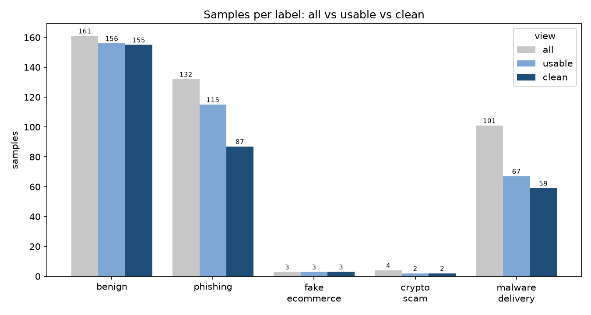
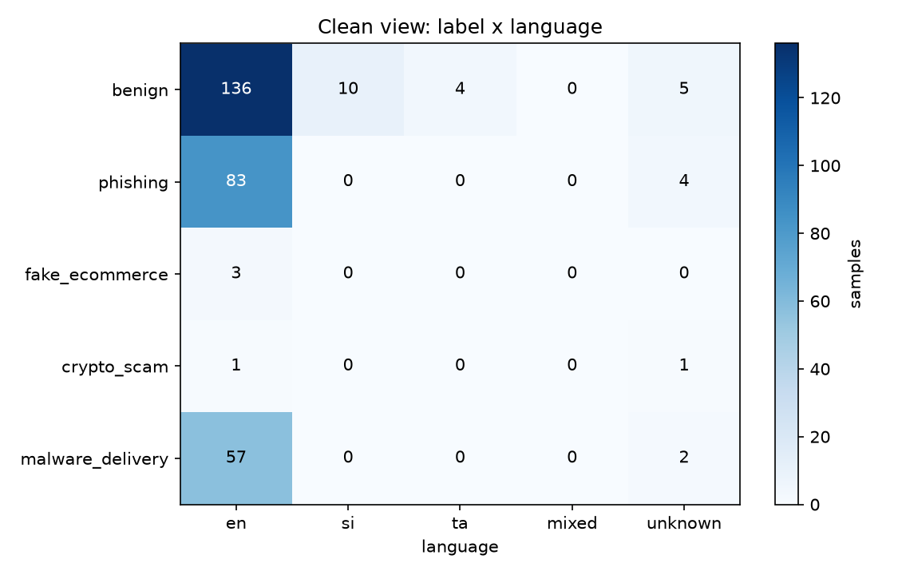
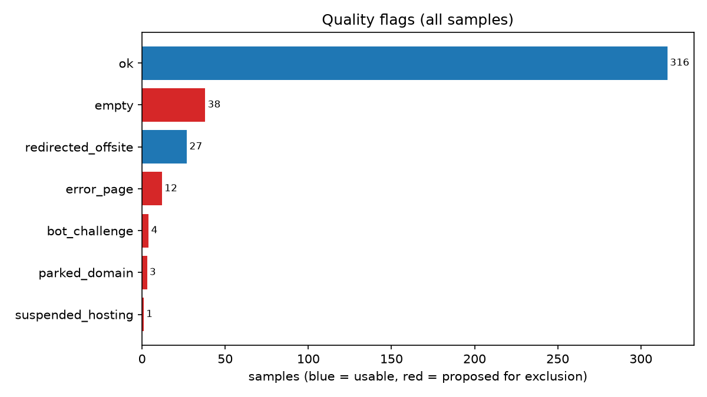
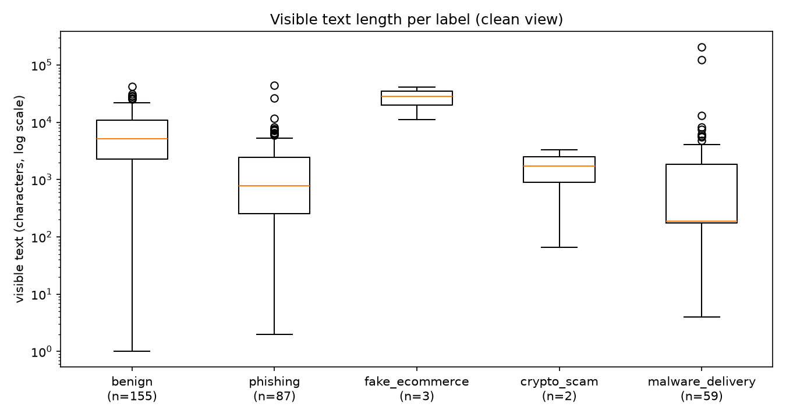
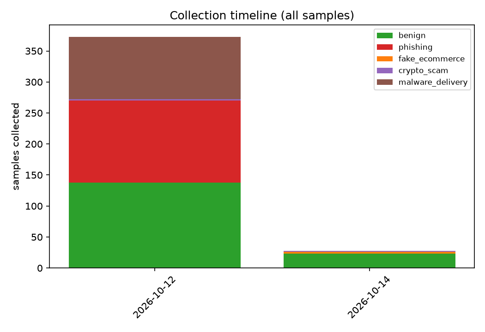
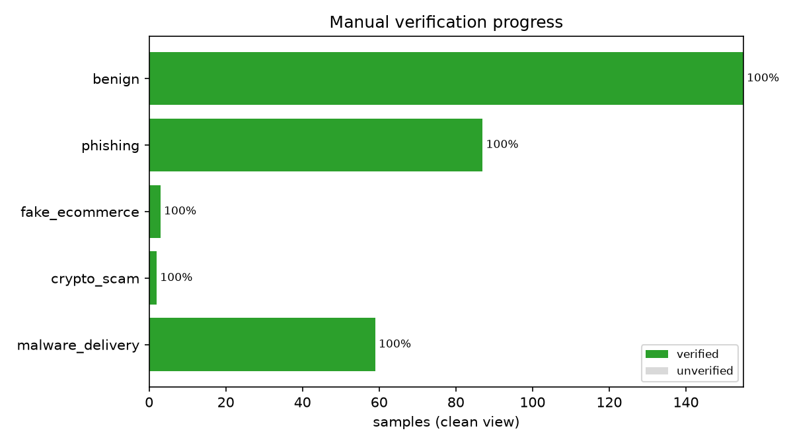

# C2 dataset statistics

- Generated: 2026-10-14T16:19:53+05:30
- Dataset version: **unfrozen** (latest frozen: v0.1)
- **all** view: every row in metadata.csv
- **usable** view: not excluded AND quality_flag in (ok, redirected_offsite)
- **clean** view: usable AND is_duplicate_of is empty (one row per cluster) - used for training

## Samples per label and view

| view | total | benign | phishing | fake_ecommerce | crypto_scam | malware_delivery |
|---|---|---|---|---|---|---|
| all | 401 | 161 | 132 | 3 | 4 | 101 |
| usable | 343 | 156 | 115 | 3 | 2 | 67 |
| clean | 306 | 155 | 87 | 3 | 2 | 59 |

## Readiness (clean view vs configs/collection_targets.yaml)

| label | clean / target | si / target | ta / target | status |
|---|---|---|---|---|
| benign | 155/50 | 10/20 | 4/0 | 10 more si needed |
| phishing | 87/50 | 0/20 | 0/0 | 20 more si needed |
| fake_ecommerce | 3/50 | 0/20 | 0/0 | 47 more needed, 20 more si needed |
| crypto_scam | 2/50 | 0/20 | 0/0 | 48 more needed, 20 more si needed |
| malware_delivery | 59/50 | 0/0 | 0/0 | ready |

Local-language coverage (clean): Sinhala 10 (3.3%), Tamil 4 (1.3%); mixed-language pages: 0.

## Label x language (clean view)

| label | en | si | ta | mixed | unknown | total |
|---|---|---|---|---|---|---|
| benign | 136 | 10 | 4 | 0 | 5 | 155 |
| phishing | 83 | 0 | 0 | 0 | 4 | 87 |
| fake_ecommerce | 3 | 0 | 0 | 0 | 0 | 3 |
| crypto_scam | 1 | 0 | 0 | 0 | 1 | 2 |
| malware_delivery | 57 | 0 | 0 | 0 | 2 | 59 |
| **total** | 280 | 10 | 4 | 0 | 12 | 306 |

## Class balance (clean view)

| label | samples | % of total |
|---|---|---|
| benign | 155 | 50.7 |
| phishing | 87 | 28.4 |
| fake_ecommerce | 3 | 1.0 |
| crypto_scam | 2 | 0.7 |
| malware_delivery | 59 | 19.3 |

Majority/minority ratio: **77.5** (majority benign, minority crypto_scam).

## Verification (clean view)

| label | verified | unverified | % verified |
|---|---|---|---|
| benign | 155 | 0 | 100.0 |
| phishing | 87 | 0 | 100.0 |
| fake_ecommerce | 3 | 0 | 100.0 |
| crypto_scam | 2 | 0 | 100.0 |
| malware_delivery | 59 | 0 | 100.0 |

## Page statistics (clean view)

| label | pages | size median | size p90 | text chars median | text chars p90 | forms (mean) | % password field | % script |
|---|---|---|---|---|---|---|---|---|
| benign | 155 | 212.8 KB | 837.1 KB | 5,233 | 16,948 | 1.31 | 2.6 | 96.8 |
| phishing | 87 | 33.3 KB | 260.4 KB | 776 | 6,544 | 0.74 | 32.2 | 92.0 |
| fake_ecommerce | 3 | 1696.2 KB | 2020.7 KB | 28,466 | 38,480 | 1.33 | 0.0 | 100.0 |
| crypto_scam | 2 | 12.8 KB | 17.8 KB | 1,712 | 3,029 | 0.0 | 0.0 | 100.0 |
| malware_delivery | 59 | 122.1 KB | 180.9 KB | 189 | 5,943 | 0.69 | 5.1 | 79.7 |

## Quality flags and exclusions (all view)

| quality_flag | samples | usable? |
|---|---|---|
| ok | 316 | yes |
| empty | 38 | no |
| parked_domain | 3 | no |
| error_page | 12 | no |
| bot_challenge | 4 | no |
| suspended_hosting | 1 | no |
| redirected_offsite | 27 | yes |

No samples excluded yet.

## Sources and fetch modes

| source | all | usable | clean |
|---|---|---|---|
| openphish | 132 | 115 | 87 |
| urlhaus | 101 | 67 | 59 |
| tranco | 99 | 96 | 96 |
| manual | 62 | 60 | 59 |
| other | 7 | 5 | 5 |

| fetch_mode | all | usable | clean |
|---|---|---|---|
| static | 401 | 343 | 306 |
| rendered | 0 | 0 | 0 |
| manual | 0 | 0 | 0 |

## Near-duplicate clusters

| view | clusters | with 2+ pages | rows without cluster |
|---|---|---|---|
| all | 364 | 20 | 0 |
| usable | 306 | 20 | 0 |
| clean | 306 | 0 | 0 |

Duplicates per label (all view): benign 1, phishing 28, fake_ecommerce 0, crypto_scam 0, malware_delivery 8

Largest clusters (all view):

| cluster_id | label | size |
|---|---|---|
| cl_000264 | phishing | 11 |
| cl_000278 | phishing | 5 |
| cl_000211 | malware_delivery | 4 |
| cl_000168 | malware_delivery | 3 |
| cl_000182 | malware_delivery | 3 |
| cl_000306 | phishing | 3 |
| cl_000125 | benign | 2 |
| cl_000186 | malware_delivery | 2 |
| cl_000261 | phishing | 2 |
| cl_000273 | phishing | 2 |

## Relabels during review (all view)

No samples relabelled yet.

## Collection timeline (all view)

| collection_date | benign | phishing | fake_ecommerce | crypto_scam | malware_delivery | total |
|---|---|---|---|---|---|---|
| 2026-10-12 | 138 | 132 | 0 | 2 | 101 | 373 |
| 2026-10-14 | 23 | 0 | 3 | 2 | 0 | 28 |

## Peer agreement

Not done yet (review_labels.py export-peer / import-peer).

## Figures

