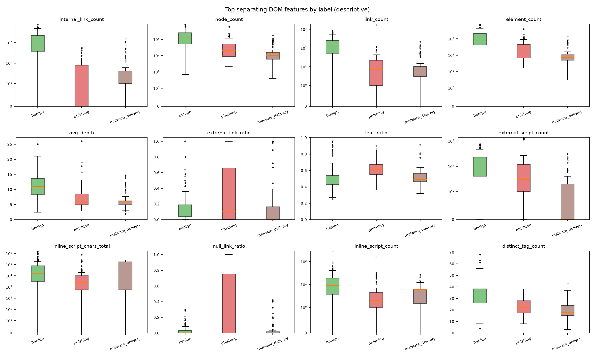
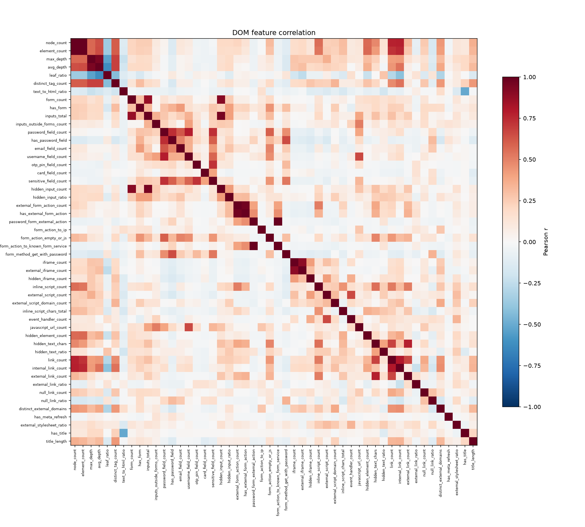

# DOM features summary - dataset v0.1

- Generated: 2026-10-14T09:50:49+05:30
- Feature set: dom_v1 (52 features, dictionary 8605201ec979)
- Rows in dom_features.csv: 278
- This run: 278 page(s) - processed 278, unchanged 0, failed 0; Part 2 run for 0 missing page(s); pages with a failed feature group: 0
- Time per page: avg 19.6 ms, p95 83.5 ms, max 140.48 ms (wall time 3.5 s)

> Descriptive statistics only - no model. Separation = mutual information with the label; spread = (largest - smallest label median) / overall IQR.

## Most separating features

| feature | MI | spread | median benign | median phishing | median malware_delivery | % non-zero benign | % non-zero phishing | % non-zero malware_delivery |
|---|---|---|---|---|---|---|---|---|
| internal_link_count | 0.466 | 1.04 | 88.5 | 0 | 4 | 90.9 | 43.7 | 79.7 |
| node_count | 0.42 | 0.905 | 1,344 | 200 | 100 | 100 | 100 | 100 |
| link_count | 0.386 | 0.98 | 114 | 7 | 4 | 93.9 | 82.8 | 88.1 |
| element_count | 0.329 | 0.975 | 1,114 | 163 | 73 | 100 | 100 | 100 |
| avg_depth | 0.297 | 0.828 | 11 | 6.1 | 6.09 | 100 | 100 | 100 |
| external_link_ratio | 0.296 | 0.362 | 0.0852 | 0.1 | 0 | 90.9 | 52.9 | 35.6 |
| leaf_ratio | 0.283 | 0.888 | 0.472 | 0.613 | 0.489 | 100 | 100 | 100 |
| external_script_count | 0.267 | 0.786 | 11 | 3 | 0 | 93.2 | 80.5 | 32.2 |
| inline_script_chars_total | 0.256 | 0.244 | 14,976 | 2,433 | 12,168 | 92.4 | 82.8 | 78 |
| null_link_ratio | 0.248 | 1.77 | 0.0109 | 0.167 | 0 | 60.6 | 58.6 | 25.4 |
| inline_script_count | 0.242 | 0.636 | 9 | 2 | 6 | 92.4 | 82.8 | 78 |
| distinct_tag_count | 0.233 | 0.933 | 32 | 22 | 18 | 100 | 100 | 100 |

## Warnings

- Constant features (2): base_url_known, meta_refresh_external
- Near-constant features (10): username_field_count (97%), otp_pin_field_count (99%), card_field_count (99%), external_form_action_count (97%), has_external_form_action (97%), password_form_external_action (99%), form_action_to_ip (99%), form_action_to_known_form_service (99%), has_meta_refresh (99%), has_title (98%)
- Highly correlated pairs (3): password_form_external_action ~ form_action_to_known_form_service (r=1.0), node_count ~ element_count (r=0.9944), external_form_action_count ~ has_external_form_action (r=0.9611)

## All features per label (median / mean / % non-zero)

| feature | group | benign | phishing | malware_delivery |
|---|---|---|---|---|
| base_url_known | context | 1 / 1 / 100% | 1 / 1 / 100% | 1 / 1 / 100% |
| node_count | structure | 1,344 / 1,755 / 100% | 200 / 485 / 100% | 100 / 242 / 100% |
| element_count | structure | 1,114 / 1,442 / 100% | 163 / 373 / 100% | 73 / 193 / 100% |
| max_depth | structure | 18 / 17.9 / 100% | 11 / 13.1 / 100% | 10 / 11.3 / 100% |
| avg_depth | structure | 11 / 11.1 / 100% | 6.1 / 7.3 / 100% | 6.09 / 6.67 / 100% |
| leaf_ratio | structure | 0.472 / 0.504 / 100% | 0.613 / 0.617 / 100% | 0.489 / 0.529 / 100% |
| distinct_tag_count | structure | 32 / 31.7 / 100% | 22 / 22.4 / 100% | 18 / 20.1 / 100% |
| text_to_html_ratio | structure | 0.021 / 0.0454 / 92.4% | 0.0282 / 0.042 / 94.3% | 0.0024 / 0.0849 / 96.6% |
| form_count | forms | 0 / 1.39 / 44.7% | 0 / 0.736 / 40.2% | 0 / 0.695 / 30.5% |
| has_form | forms | 0 / 0.447 / 44.7% | 0 / 0.402 / 40.2% | 0 / 0.305 / 30.5% |
| inputs_total | forms | 1 / 4.27 / 59.8% | 2 / 3.87 / 78.2% | 0 / 2.86 / 33.9% |
| inputs_outside_forms_count | forms | 0 / 0.811 / 29.5% | 0 / 1.44 / 48.3% | 0 / 0.288 / 6.78% |
| password_field_count | credentials | 0 / 0.0909 / 3.03% | 0 / 0.414 / 32.2% | 0 / 0.0678 / 5.08% |
| has_password_field | credentials | 0 / 0.0303 / 3.03% | 0 / 0.322 / 32.2% | 0 / 0.0508 / 5.08% |
| email_field_count | credentials | 0 / 0.204 / 15.2% | 0 / 0.368 / 34.5% | 0 / 0.17 / 13.6% |
| username_field_count | credentials | 0 / 0.0379 / 1.52% | 0 / 0.092 / 5.75% | 0 / 0.0508 / 3.39% |
| otp_pin_field_count | credentials | 0 / 0 / 0% | 0 / 0.172 / 3.45% | 0 / 0 / 0% |
| card_field_count | credentials | 0 / 0 / 0% | 0 / 0.115 / 3.45% | 0 / 0 / 0% |
| sensitive_field_count | credentials | 0 / 0.0909 / 3.03% | 0 / 0.701 / 33.3% | 0 / 0.0678 / 5.08% |
| hidden_input_count | hidden_inputs | 0 / 2.65 / 31.1% | 0 / 1.75 / 23% | 0 / 1.64 / 20.3% |
| hidden_input_ratio | hidden_inputs | 0 / 0.216 / 31.1% | 0 / 0.144 / 23% | 0 / 0.147 / 20.3% |
| external_form_action_count | form_actions | 0 / 0.0379 / 3.03% | 0 / 0.0345 / 3.45% | 0 / 0.0339 / 3.39% |
| has_external_form_action | form_actions | 0 / 0.0303 / 3.03% | 0 / 0.0345 / 3.45% | 0 / 0.0339 / 3.39% |
| password_form_external_action | form_actions | 0 / 0 / 0% | 0 / 0.023 / 2.3% | 0 / 0 / 0% |
| form_action_to_ip | form_actions | 0 / 0 / 0% | 0 / 0 / 0% | 0 / 0.0678 / 6.78% |
| form_action_empty_or_js | form_actions | 0 / 0.379 / 19.7% | 0 / 0.483 / 31% | 0 / 0.0678 / 5.08% |
| form_action_to_known_form_service | form_actions | 0 / 0 / 0% | 0 / 0.023 / 2.3% | 0 / 0 / 0% |
| form_method_get_with_password | form_actions | 0 / 0.0076 / 0.758% | 0 / 0.172 / 17.2% | 0 / 0 / 0% |
| iframe_count | iframes | 0 / 0.614 / 38.6% | 0 / 0.264 / 20.7% | 0 / 0.102 / 6.78% |
| external_iframe_count | iframes | 0 / 0.492 / 34.8% | 0 / 0.092 / 8.05% | 0 / 0.102 / 6.78% |
| hidden_iframe_count | iframes | 0 / 0.341 / 29.5% | 0 / 0.184 / 14.9% | 0 / 0 / 0% |
| inline_script_count | scripts | 9 / 15.7 / 92.4% | 2 / 7.01 / 82.8% | 6 / 5.29 / 78% |
| external_script_count | scripts | 11 / 16.4 / 93.2% | 3 / 16.6 / 80.5% | 0 / 2.8 / 32.2% |
| external_script_domain_count | scripts | 1 / 1.95 / 73.5% | 1 / 1.11 / 57.5% | 0 / 0.356 / 23.7% |
| inline_script_chars_total | scripts | 14,976 / 93,303 / 92.4% | 2,433 / 25,242 / 82.8% | 12,168 / 80,090 / 78% |
| event_handler_count | scripts | 0 / 6.51 / 35.6% | 0 / 15.9 / 27.6% | 0 / 1.46 / 13.6% |
| javascript_url_count | scripts | 0 / 0.568 / 9.85% | 0 / 1.09 / 11.5% | 0 / 0.746 / 1.69% |
| hidden_element_count | hidden_elements | 3 / 31.9 / 72% | 1 / 4.31 / 62.1% | 0 / 1.24 / 22% |
| hidden_text_chars | hidden_elements | 44.5 / 1,035 / 59.8% | 0 / 551 / 41.4% | 0 / 20.1 / 13.6% |
| hidden_text_ratio | hidden_elements | 0.0053 / 0.14 / 59.8% | 0 / 0.163 / 41.4% | 0 / 0.0093 / 13.6% |
| link_count | links | 114 / 179 / 93.9% | 7 / 38 / 82.8% | 4 / 21.1 / 88.1% |
| internal_link_count | links | 88.5 / 151 / 90.9% | 0 / 6.23 / 43.7% | 4 / 12.5 / 79.7% |
| external_link_count | links | 10 / 19.8 / 90.9% | 1 / 23.6 / 52.9% | 0 / 5.8 / 35.6% |
| external_link_ratio | links | 0.0852 / 0.155 / 90.9% | 0.1 / 0.345 / 52.9% | 0 / 0.195 / 35.6% |
| null_link_count | links | 1 / 7.42 / 60.6% | 2 / 8.07 / 58.6% | 0 / 2.25 / 25.4% |
| null_link_ratio | links | 0.0109 / 0.0354 / 60.6% | 0.167 / 0.338 / 58.6% | 0 / 0.0412 / 25.4% |
| distinct_external_domains | links | 7 / 8.18 / 90.9% | 1 / 1.7 / 52.9% | 0 / 2.25 / 35.6% |
| has_meta_refresh | meta_resources | 0 / 0.0152 / 1.52% | 0 / 0.0115 / 1.15% | 0 / 0.0169 / 1.69% |
| meta_refresh_external | meta_resources | 0 / 0 / 0% | 0 / 0 / 0% | 0 / 0 / 0% |
| external_stylesheet_ratio | meta_resources | 0.0417 / 0.294 / 50.8% | 0.0417 / 0.387 / 56.3% | 0 / 0.123 / 25.4% |
| has_title | meta_resources | 1 / 0.977 / 97.7% | 1 / 0.989 / 98.9% | 1 / 0.966 / 96.6% |
| title_length | meta_resources | 51 / 48.2 / 97.7% | 25 / 29.7 / 98.9% | 15 / 24.2 / 96.6% |

## Figures

