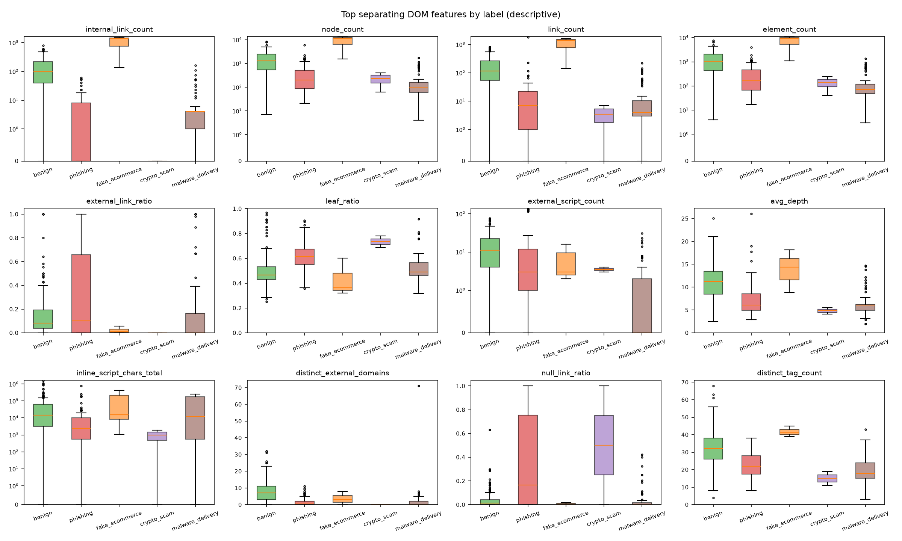
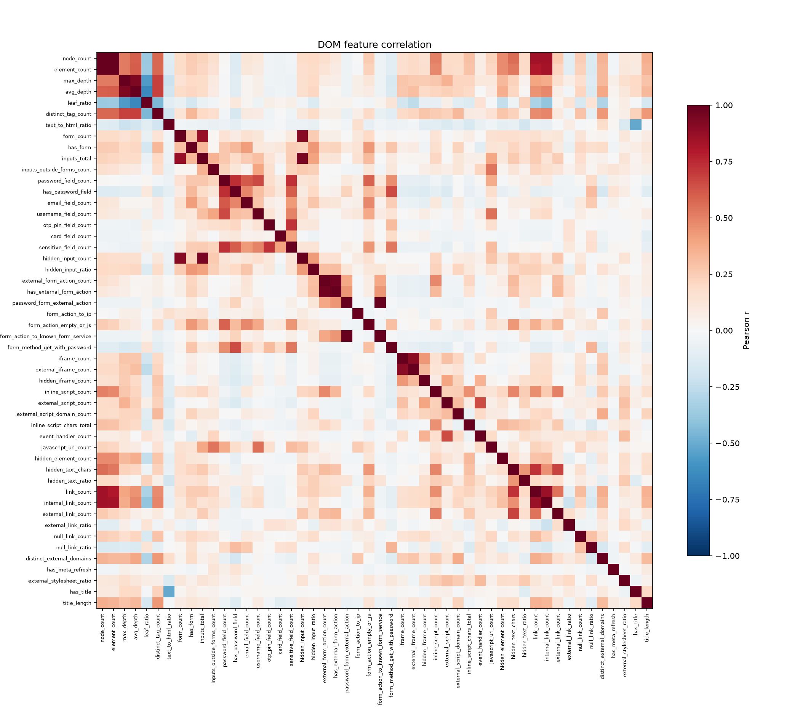

# DOM features summary - dataset v0.2

- Generated: 2026-10-14T16:31:10+05:30
- Feature set: dom_v1 (52 features, dictionary 8605201ec979)
- Rows in dom_features.csv: 306
- This run: 306 page(s) - processed 306, unchanged 0, failed 0; Part 2 run for 0 missing page(s); pages with a failed feature group: 0
- Time per page: avg 21.6 ms, p95 90.8 ms, max 271.18 ms (wall time 4.5 s)

> Descriptive statistics only - no model. Separation = mutual information with the label; spread = (largest - smallest label median) / overall IQR.

## Most separating features

| feature | MI | spread | median benign | median phishing | median fake_ecommerce | median crypto_scam | median malware_delivery | % non-zero benign | % non-zero phishing | % non-zero fake_ecommerce | % non-zero crypto_scam | % non-zero malware_delivery |
|---|---|---|---|---|---|---|---|---|---|---|---|---|
| internal_link_count | 0.433 | 12.6 | 98 | 0 | 1,357 | 0 | 4 | 91.6 | 43.7 | 100 | 0 | 79.7 |
| node_count | 0.429 | 7.76 | 1,277 | 200 | 11,055 | 232 | 100 | 100 | 100 | 100 | 100 | 100 |
| link_count | 0.378 | 11.1 | 117 | 7 | 1,382 | 3.5 | 4 | 94.2 | 82.8 | 100 | 50 | 88.1 |
| element_count | 0.324 | 8.82 | 1,055 | 163 | 9,421 | 140 | 73 | 100 | 100 | 100 | 100 | 100 |
| external_link_ratio | 0.315 | 0.384 | 0.0833 | 0.1 | 0.0089 | 0 | 0 | 91.6 | 52.9 | 66.7 | 0 | 35.6 |
| leaf_ratio | 0.296 | 2.38 | 0.466 | 0.613 | 0.361 | 0.734 | 0.489 | 100 | 100 | 100 | 100 | 100 |
| external_script_count | 0.295 | 0.733 | 11 | 3 | 3 | 3.5 | 0 | 93.5 | 80.5 | 100 | 100 | 32.2 |
| avg_depth | 0.288 | 1.55 | 11.3 | 6.1 | 14.4 | 4.82 | 6.09 | 100 | 100 | 100 | 100 | 100 |
| inline_script_chars_total | 0.261 | 0.324 | 14,835 | 2,433 | 15,710 | 972 | 12,168 | 91.6 | 82.8 | 100 | 50 | 78 |
| distinct_external_domains | 0.249 | 1 | 7 | 1 | 3 | 0 | 0 | 91.6 | 52.9 | 66.7 | 0 | 35.6 |
| null_link_ratio | 0.248 | 5.31 | 0.0127 | 0.167 | 0 | 0.5 | 0 | 63.2 | 58.6 | 33.3 | 50 | 25.4 |
| distinct_tag_count | 0.239 | 1.73 | 32 | 22 | 41 | 15 | 18 | 100 | 100 | 100 | 100 | 100 |

## Warnings

- Constant features (2): base_url_known, meta_refresh_external
- Near-constant features (10): username_field_count (97%), otp_pin_field_count (99%), card_field_count (99%), external_form_action_count (97%), has_external_form_action (97%), password_form_external_action (99%), form_action_to_ip (99%), form_action_to_known_form_service (99%), has_meta_refresh (99%), has_title (98%)
- Highly correlated pairs (3): password_form_external_action ~ form_action_to_known_form_service (r=1.0), node_count ~ element_count (r=0.996), external_form_action_count ~ has_external_form_action (r=0.9636)

## All features per label (median / mean / % non-zero)

| feature | group | benign | phishing | fake_ecommerce | crypto_scam | malware_delivery |
|---|---|---|---|---|---|---|
| base_url_known | context | 1 / 1 / 100% | 1 / 1 / 100% | 1 / 1 / 100% | 1 / 1 / 100% | 1 / 1 / 100% |
| node_count | structure | 1,277 / 1,692 / 100% | 200 / 485 / 100% | 11,055 / 8,558 / 100% | 232 / 232 / 100% | 100 / 242 / 100% |
| element_count | structure | 1,055 / 1,385 / 100% | 163 / 373 / 100% | 9,421 / 7,086 / 100% | 140 / 140 / 100% | 73 / 193 / 100% |
| max_depth | structure | 18 / 18 / 100% | 11 / 13.1 / 100% | 20 / 19 / 100% | 7 / 7 / 100% | 10 / 11.3 / 100% |
| avg_depth | structure | 11.3 / 11.2 / 100% | 6.1 / 7.3 / 100% | 14.4 / 13.8 / 100% | 4.82 / 4.82 / 100% | 6.09 / 6.67 / 100% |
| leaf_ratio | structure | 0.466 / 0.498 / 100% | 0.613 / 0.617 / 100% | 0.361 / 0.429 / 100% | 0.734 / 0.734 / 100% | 0.489 / 0.529 / 100% |
| distinct_tag_count | structure | 32 / 31.4 / 100% | 22 / 22.4 / 100% | 41 / 41.7 / 100% | 15 / 15 / 100% | 18 / 20.1 / 100% |
| text_to_html_ratio | structure | 0.0227 / 0.0437 / 91.6% | 0.0282 / 0.042 / 94.3% | 0.0151 / 0.0241 / 100% | 0.0895 / 0.0895 / 100% | 0.0024 / 0.0849 / 96.6% |
| form_count | forms | 0 / 1.31 / 45.2% | 0 / 0.736 / 40.2% | 1 / 1.33 / 100% | 0 / 0 / 0% | 0 / 0.695 / 30.5% |
| has_form | forms | 0 / 0.452 / 45.2% | 0 / 0.402 / 40.2% | 1 / 1 / 100% | 0 / 0 / 0% | 0 / 0.305 / 30.5% |
| inputs_total | forms | 1 / 4.03 / 61.3% | 2 / 3.87 / 78.2% | 3 / 5.33 / 100% | 0 / 0 / 0% | 0 / 2.86 / 33.9% |
| inputs_outside_forms_count | forms | 0 / 0.761 / 28.4% | 0 / 1.44 / 48.3% | 2 / 4 / 66.7% | 0 / 0 / 0% | 0 / 0.288 / 6.78% |
| password_field_count | credentials | 0 / 0.0774 / 2.58% | 0 / 0.414 / 32.2% | 0 / 0 / 0% | 0 / 0 / 0% | 0 / 0.0678 / 5.08% |
| has_password_field | credentials | 0 / 0.0258 / 2.58% | 0 / 0.322 / 32.2% | 0 / 0 / 0% | 0 / 0 / 0% | 0 / 0.0508 / 5.08% |
| email_field_count | credentials | 0 / 0.187 / 14.2% | 0 / 0.368 / 34.5% | 1 / 0.667 / 66.7% | 0 / 0 / 0% | 0 / 0.17 / 13.6% |
| username_field_count | credentials | 0 / 0.0581 / 1.94% | 0 / 0.092 / 5.75% | 0 / 0 / 0% | 0 / 0 / 0% | 0 / 0.0508 / 3.39% |
| otp_pin_field_count | credentials | 0 / 0 / 0% | 0 / 0.172 / 3.45% | 0 / 0 / 0% | 0 / 0 / 0% | 0 / 0 / 0% |
| card_field_count | credentials | 0 / 0 / 0% | 0 / 0.115 / 3.45% | 0 / 0 / 0% | 0 / 0 / 0% | 0 / 0 / 0% |
| sensitive_field_count | credentials | 0 / 0.0774 / 2.58% | 0 / 0.701 / 33.3% | 0 / 0 / 0% | 0 / 0 / 0% | 0 / 0.0678 / 5.08% |
| hidden_input_count | hidden_inputs | 0 / 2.45 / 31.6% | 0 / 1.75 / 23% | 0 / 3 / 33.3% | 0 / 0 / 0% | 0 / 1.64 / 20.3% |
| hidden_input_ratio | hidden_inputs | 0 / 0.22 / 31.6% | 0 / 0.144 / 23% | 0 / 0.273 / 33.3% | 0 / 0 / 0% | 0 / 0.147 / 20.3% |
| external_form_action_count | form_actions | 0 / 0.0387 / 3.23% | 0 / 0.0345 / 3.45% | 0 / 0 / 0% | 0 / 0 / 0% | 0 / 0.0339 / 3.39% |
| has_external_form_action | form_actions | 0 / 0.0323 / 3.23% | 0 / 0.0345 / 3.45% | 0 / 0 / 0% | 0 / 0 / 0% | 0 / 0.0339 / 3.39% |
| password_form_external_action | form_actions | 0 / 0 / 0% | 0 / 0.023 / 2.3% | 0 / 0 / 0% | 0 / 0 / 0% | 0 / 0 / 0% |
| form_action_to_ip | form_actions | 0 / 0 / 0% | 0 / 0 / 0% | 0 / 0 / 0% | 0 / 0 / 0% | 0 / 0.0678 / 6.78% |
| form_action_empty_or_js | form_actions | 0 / 0.348 / 18.1% | 0 / 0.483 / 31% | 1 / 0.667 / 66.7% | 0 / 0 / 0% | 0 / 0.0678 / 5.08% |
| form_action_to_known_form_service | form_actions | 0 / 0 / 0% | 0 / 0.023 / 2.3% | 0 / 0 / 0% | 0 / 0 / 0% | 0 / 0 / 0% |
| form_method_get_with_password | form_actions | 0 / 0.0065 / 0.645% | 0 / 0.172 / 17.2% | 0 / 0 / 0% | 0 / 0 / 0% | 0 / 0 / 0% |
| iframe_count | iframes | 0 / 0.6 / 38.1% | 0 / 0.264 / 20.7% | 0 / 0.333 / 33.3% | 0 / 0 / 0% | 0 / 0.102 / 6.78% |
| external_iframe_count | iframes | 0 / 0.49 / 34.2% | 0 / 0.092 / 8.05% | 0 / 0.333 / 33.3% | 0 / 0 / 0% | 0 / 0.102 / 6.78% |
| hidden_iframe_count | iframes | 0 / 0.323 / 27.7% | 0 / 0.184 / 14.9% | 0 / 0.333 / 33.3% | 0 / 0 / 0% | 0 / 0 / 0% |
| inline_script_count | scripts | 8 / 14.9 / 91.6% | 2 / 7.01 / 82.8% | 8 / 21 / 100% | 0.5 / 0.5 / 50% | 6 / 5.29 / 78% |
| external_script_count | scripts | 11 / 16 / 93.5% | 3 / 16.6 / 80.5% | 3 / 7 / 100% | 3.5 / 3.5 / 100% | 0 / 2.8 / 32.2% |
| external_script_domain_count | scripts | 1 / 1.97 / 75.5% | 1 / 1.11 / 57.5% | 0 / 0.333 / 33.3% | 0.5 / 0.5 / 50% | 0 / 0.356 / 23.7% |
| inline_script_chars_total | scripts | 14,835 / 83,074 / 91.6% | 2,433 / 25,242 / 82.8% | 15,710 / 145,910 / 100% | 972 / 972 / 50% | 12,168 / 80,090 / 78% |
| event_handler_count | scripts | 0 / 6.52 / 38.7% | 0 / 15.9 / 27.6% | 0 / 0.667 / 33.3% | 6.5 / 6.5 / 50% | 0 / 1.46 / 13.6% |
| javascript_url_count | scripts | 0 / 0.535 / 9.68% | 0 / 1.09 / 11.5% | 0 / 8.33 / 33.3% | 0 / 0 / 0% | 0 / 0.746 / 1.69% |
| hidden_element_count | hidden_elements | 4 / 31.3 / 71.6% | 1 / 4.31 / 62.1% | 34 / 28.7 / 100% | 0 / 0 / 0% | 0 / 1.24 / 22% |
| hidden_text_chars | hidden_elements | 37 / 927 / 58.1% | 0 / 551 / 41.4% | 8,237 / 13,042 / 100% | 0 / 0 / 0% | 0 / 20.1 / 13.6% |
| hidden_text_ratio | hidden_elements | 0.0047 / 0.129 / 58.1% | 0 / 0.163 / 41.4% | 0.372 / 0.506 / 100% | 0 / 0 / 0% | 0 / 0.0093 / 13.6% |
| link_count | links | 117 / 177 / 94.2% | 7 / 38 / 82.8% | 1,382 / 1,034 / 100% | 3.5 / 3.5 / 50% | 4 / 21.1 / 88.1% |
| internal_link_count | links | 98 / 149 / 91.6% | 0 / 6.23 / 43.7% | 1,357 / 1,018 / 100% | 0 / 0 / 0% | 4 / 12.5 / 79.7% |
| external_link_count | links | 10 / 18.6 / 91.6% | 1 / 23.6 / 52.9% | 8 / 7.33 / 66.7% | 0 / 0 / 0% | 0 / 5.8 / 35.6% |
| external_link_ratio | links | 0.0833 / 0.155 / 91.6% | 0.1 / 0.345 / 52.9% | 0.0089 / 0.0216 / 66.7% | 0 / 0 / 0% | 0 / 0.195 / 35.6% |
| null_link_count | links | 2 / 9.19 / 63.2% | 2 / 8.07 / 58.6% | 0 / 8.33 / 33.3% | 3.5 / 3.5 / 50% | 0 / 2.25 / 25.4% |
| null_link_ratio | links | 0.0127 / 0.0415 / 63.2% | 0.167 / 0.338 / 58.6% | 0 / 0.006 / 33.3% | 0.5 / 0.5 / 50% | 0 / 0.0412 / 25.4% |
| distinct_external_domains | links | 7 / 7.9 / 91.6% | 1 / 1.7 / 52.9% | 3 / 3.67 / 66.7% | 0 / 0 / 0% | 0 / 2.25 / 35.6% |
| has_meta_refresh | meta_resources | 0 / 0.0129 / 1.29% | 0 / 0.0115 / 1.15% | 0 / 0 / 0% | 0 / 0 / 0% | 0 / 0.0169 / 1.69% |
| meta_refresh_external | meta_resources | 0 / 0 / 0% | 0 / 0 / 0% | 0 / 0 / 0% | 0 / 0 / 0% | 0 / 0 / 0% |
| external_stylesheet_ratio | meta_resources | 0.0588 / 0.284 / 53.5% | 0.0417 / 0.387 / 56.3% | 0 / 0.333 / 33.3% | 0 / 0 / 0% | 0 / 0.123 / 25.4% |
| has_title | meta_resources | 1 / 0.981 / 98.1% | 1 / 0.989 / 98.9% | 1 / 1 / 100% | 1 / 1 / 100% | 1 / 0.966 / 96.6% |
| title_length | meta_resources | 48 / 47 / 98.1% | 25 / 29.7 / 98.9% | 51 / 55.3 / 100% | 17 / 17 / 100% | 15 / 24.2 / 96.6% |

## Figures

