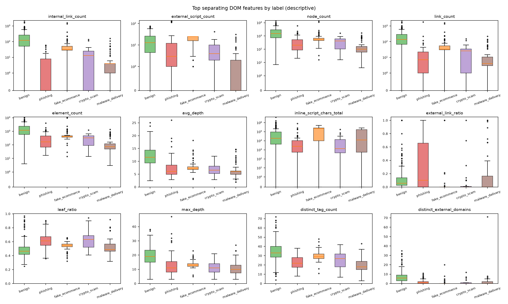
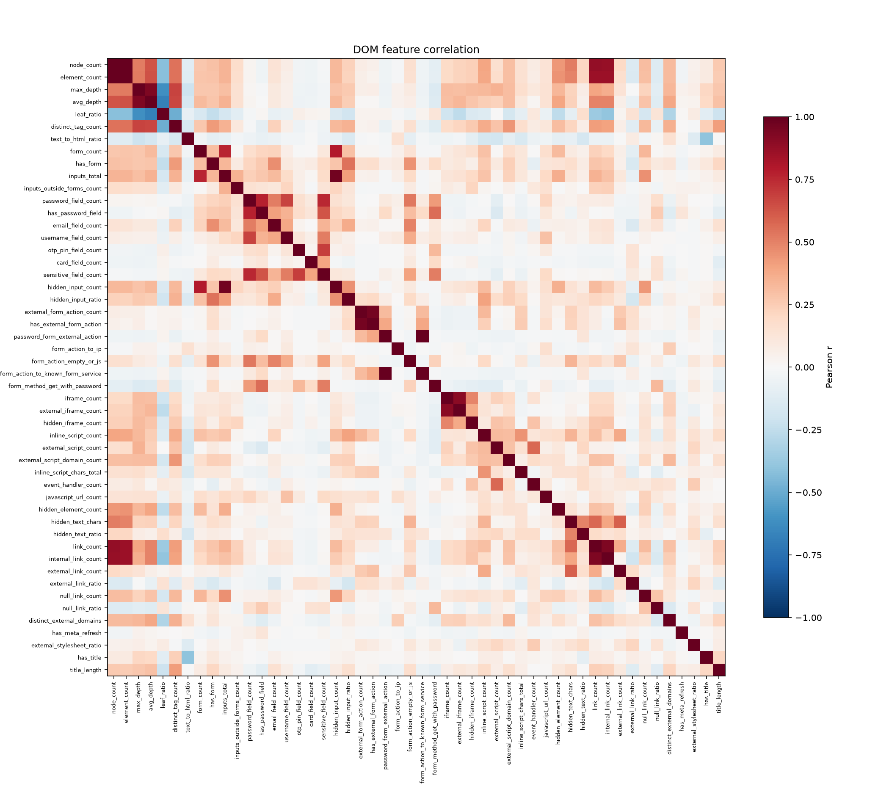

# DOM features summary - dataset v0.3

- Generated: 2026-10-14T22:48:57+05:30
- Feature set: dom_v1 (52 features, dictionary 8605201ec979)
- Rows in dom_features.csv: 459
- This run: 459 page(s) - processed 459, unchanged 0, failed 0; Part 2 run for 0 missing page(s); pages with a failed feature group: 0
- Time per page: avg 60.4 ms, p95 219.6 ms, max 1221.39 ms (wall time 10.8 s)

> Descriptive statistics only - no model. Separation = mutual information with the label; spread = (largest - smallest label median) / overall IQR.

## Most separating features

| feature | MI | spread | median benign | median phishing | median fake_ecommerce | median crypto_scam | median malware_delivery | % non-zero benign | % non-zero phishing | % non-zero fake_ecommerce | % non-zero crypto_scam | % non-zero malware_delivery |
|---|---|---|---|---|---|---|---|---|---|---|---|---|
| internal_link_count | 0.52 | 0.921 | 123 | 0 | 31 | 13 | 4 | 93.4 | 43.7 | 91.2 | 69 | 79.7 |
| external_script_count | 0.465 | 1.19 | 13 | 3 | 25 | 4 | 0 | 95.2 | 80.5 | 98.2 | 96.6 | 32.2 |
| node_count | 0.447 | 0.952 | 1,515 | 200 | 521 | 417 | 100 | 100 | 100 | 100 | 100 | 100 |
| link_count | 0.441 | 0.862 | 138 | 7 | 33 | 26 | 4 | 95.6 | 82.8 | 98.2 | 75.9 | 88.1 |
| element_count | 0.407 | 0.921 | 1,185 | 163 | 412 | 332 | 73 | 100 | 100 | 100 | 100 | 100 |
| avg_depth | 0.389 | 0.921 | 11.6 | 6.1 | 7.15 | 6.61 | 6.09 | 100 | 100 | 100 | 100 | 100 |
| inline_script_chars_total | 0.366 | 1.91 | 18,843 | 2,433 | 222,332 | 1,343 | 12,168 | 93.4 | 82.8 | 96.5 | 89.7 | 78 |
| external_link_ratio | 0.361 | 0.603 | 0.0583 | 0.1 | 0 | 0 | 0 | 93 | 52.9 | 19.3 | 27.6 | 35.6 |
| leaf_ratio | 0.306 | 1.19 | 0.464 | 0.613 | 0.548 | 0.634 | 0.489 | 100 | 100 | 100 | 100 | 100 |
| max_depth | 0.295 | 0.9 | 19 | 11 | 13 | 11 | 10 | 100 | 100 | 100 | 100 | 100 |
| distinct_tag_count | 0.274 | 1 | 33 | 22 | 29 | 27 | 18 | 100 | 100 | 100 | 100 | 100 |
| distinct_external_domains | 0.27 | 1 | 6 | 1 | 0 | 0 | 0 | 93 | 52.9 | 19.3 | 27.6 | 35.6 |

## Warnings

- Constant features (2): base_url_known, meta_refresh_external
- Near-constant features (11): username_field_count (96%), otp_pin_field_count (99%), card_field_count (99%), external_form_action_count (97%), has_external_form_action (97%), password_form_external_action (100%), form_action_to_ip (99%), form_action_to_known_form_service (100%), form_method_get_with_password (96%), has_meta_refresh (99%), has_title (98%)
- Highly correlated pairs (4): password_form_external_action ~ form_action_to_known_form_service (r=1.0), node_count ~ element_count (r=0.9965), inputs_total ~ hidden_input_count (r=0.9653), external_form_action_count ~ has_external_form_action (r=0.9532)

## All features per label (median / mean / % non-zero)

| feature | group | benign | phishing | fake_ecommerce | crypto_scam | malware_delivery |
|---|---|---|---|---|---|---|
| base_url_known | context | 1 / 1 / 100% | 1 / 1 / 100% | 1 / 1 / 100% | 1 / 1 / 100% | 1 / 1 / 100% |
| node_count | structure | 1,515 / 2,061 / 100% | 200 / 485 / 100% | 521 / 1,077 / 100% | 417 / 434 / 100% | 100 / 242 / 100% |
| element_count | structure | 1,185 / 1,686 / 100% | 163 / 373 / 100% | 412 / 861 / 100% | 332 / 326 / 100% | 73 / 193 / 100% |
| max_depth | structure | 19 / 19.1 / 100% | 11 / 13.1 / 100% | 13 / 13.4 / 100% | 11 / 10.7 / 100% | 10 / 11.3 / 100% |
| avg_depth | structure | 11.6 / 11.8 / 100% | 6.1 / 7.3 / 100% | 7.15 / 7.96 / 100% | 6.61 / 6.46 / 100% | 6.09 / 6.67 / 100% |
| leaf_ratio | structure | 0.464 / 0.485 / 100% | 0.613 / 0.617 / 100% | 0.548 / 0.538 / 100% | 0.634 / 0.632 / 100% | 0.489 / 0.529 / 100% |
| distinct_tag_count | structure | 33 / 34.1 / 100% | 22 / 22.4 / 100% | 29 / 29.6 / 100% | 27 / 24.2 / 100% | 18 / 20.1 / 100% |
| text_to_html_ratio | structure | 0.0203 / 0.0389 / 94.3% | 0.0282 / 0.042 / 94.3% | 0.007 / 0.032 / 100% | 0.0384 / 0.0739 / 86.2% | 0.0024 / 0.0849 / 96.6% |
| form_count | forms | 1 / 2.77 / 57.7% | 0 / 0.736 / 40.2% | 1 / 2.23 / 78.9% | 0 / 0.448 / 31% | 0 / 0.695 / 30.5% |
| has_form | forms | 1 / 0.577 / 57.7% | 0 / 0.402 / 40.2% | 1 / 0.789 / 78.9% | 0 / 0.31 / 31% | 0 / 0.305 / 30.5% |
| inputs_total | forms | 2 / 9.66 / 71.4% | 2 / 3.87 / 78.2% | 5 / 5.18 / 78.9% | 0 / 2.24 / 37.9% | 0 / 2.86 / 33.9% |
| inputs_outside_forms_count | forms | 0 / 1.87 / 35.7% | 0 / 1.44 / 48.3% | 0 / 0.298 / 10.5% | 0 / 0.621 / 27.6% | 0 / 0.288 / 6.78% |
| password_field_count | credentials | 0 / 0.0969 / 5.29% | 0 / 0.414 / 32.2% | 0 / 0.123 / 7.02% | 0 / 0.0345 / 3.45% | 0 / 0.0678 / 5.08% |
| has_password_field | credentials | 0 / 0.0529 / 5.29% | 0 / 0.322 / 32.2% | 0 / 0.0702 / 7.02% | 0 / 0.0345 / 3.45% | 0 / 0.0508 / 5.08% |
| email_field_count | credentials | 0 / 0.383 / 26.9% | 0 / 0.368 / 34.5% | 1 / 0.86 / 71.9% | 0 / 0.31 / 24.1% | 0 / 0.17 / 13.6% |
| username_field_count | credentials | 0 / 0.0617 / 2.2% | 0 / 0.092 / 5.75% | 0 / 0.0526 / 5.26% | 0 / 0.0345 / 3.45% | 0 / 0.0508 / 3.39% |
| otp_pin_field_count | credentials | 0 / 0 / 0% | 0 / 0.172 / 3.45% | 0 / 0 / 0% | 0 / 0 / 0% | 0 / 0 / 0% |
| card_field_count | credentials | 0 / 0 / 0% | 0 / 0.115 / 3.45% | 0 / 0 / 0% | 0 / 0.0345 / 3.45% | 0 / 0 / 0% |
| sensitive_field_count | credentials | 0 / 0.0969 / 5.29% | 0 / 0.701 / 33.3% | 0 / 0.123 / 7.02% | 0 / 0.069 / 3.45% | 0 / 0.0678 / 5.08% |
| hidden_input_count | hidden_inputs | 0 / 6.82 / 45.8% | 0 / 1.75 / 23% | 4 / 3.18 / 68.4% | 0 / 0.862 / 17.2% | 0 / 1.64 / 20.3% |
| hidden_input_ratio | hidden_inputs | 0 / 0.314 / 45.8% | 0 / 0.144 / 23% | 0.667 / 0.478 / 68.4% | 0 / 0.0772 / 17.2% | 0 / 0.147 / 20.3% |
| external_form_action_count | form_actions | 0 / 0.0352 / 3.08% | 0 / 0.0345 / 3.45% | 0 / 0.0351 / 1.75% | 0 / 0 / 0% | 0 / 0.0339 / 3.39% |
| has_external_form_action | form_actions | 0 / 0.0308 / 3.08% | 0 / 0.0345 / 3.45% | 0 / 0.0175 / 1.75% | 0 / 0 / 0% | 0 / 0.0339 / 3.39% |
| password_form_external_action | form_actions | 0 / 0 / 0% | 0 / 0.023 / 2.3% | 0 / 0 / 0% | 0 / 0 / 0% | 0 / 0 / 0% |
| form_action_to_ip | form_actions | 0 / 0 / 0% | 0 / 0 / 0% | 0 / 0 / 0% | 0 / 0 / 0% | 0 / 0.0678 / 6.78% |
| form_action_empty_or_js | form_actions | 0 / 0.352 / 19.4% | 0 / 0.483 / 31% | 1 / 0.93 / 70.2% | 0 / 0.31 / 20.7% | 0 / 0.0678 / 5.08% |
| form_action_to_known_form_service | form_actions | 0 / 0 / 0% | 0 / 0.023 / 2.3% | 0 / 0 / 0% | 0 / 0 / 0% | 0 / 0 / 0% |
| form_method_get_with_password | form_actions | 0 / 0.0044 / 0.441% | 0 / 0.172 / 17.2% | 0 / 0 / 0% | 0 / 0 / 0% | 0 / 0 / 0% |
| iframe_count | iframes | 0 / 0.617 / 42.3% | 0 / 0.264 / 20.7% | 0 / 0.0351 / 3.51% | 0 / 0.138 / 13.8% | 0 / 0.102 / 6.78% |
| external_iframe_count | iframes | 0 / 0.507 / 37.4% | 0 / 0.092 / 8.05% | 0 / 0.0351 / 3.51% | 0 / 0.138 / 13.8% | 0 / 0.102 / 6.78% |
| hidden_iframe_count | iframes | 0 / 0.37 / 33% | 0 / 0.184 / 14.9% | 0 / 0.0351 / 3.51% | 0 / 0.0345 / 3.45% | 0 / 0 / 0% |
| inline_script_count | scripts | 10 / 19.5 / 93.4% | 2 / 7.01 / 82.8% | 27 / 22.3 / 96.5% | 2 / 5.41 / 89.7% | 6 / 5.29 / 78% |
| external_script_count | scripts | 13 / 17.5 / 95.2% | 3 / 16.6 / 80.5% | 25 / 18.8 / 98.2% | 4 / 7 / 96.6% | 0 / 2.8 / 32.2% |
| external_script_domain_count | scripts | 1 / 2.24 / 79.7% | 1 / 1.11 / 57.5% | 0 / 0.456 / 29.8% | 1 / 1.17 / 65.5% | 0 / 0.356 / 23.7% |
| inline_script_chars_total | scripts | 18,843 / 111,634 / 93.4% | 2,433 / 25,242 / 82.8% | 222,332 / 179,222 / 96.5% | 1,343 / 16,669 / 89.7% | 12,168 / 80,090 / 78% |
| event_handler_count | scripts | 0 / 6.58 / 47.6% | 0 / 15.9 / 27.6% | 0 / 0.386 / 10.5% | 0 / 1.93 / 31% | 0 / 1.46 / 13.6% |
| javascript_url_count | scripts | 0 / 1.24 / 13.2% | 0 / 1.09 / 11.5% | 0 / 0.456 / 3.51% | 0 / 0.241 / 10.3% | 0 / 0.746 / 1.69% |
| hidden_element_count | hidden_elements | 6 / 36.3 / 77.5% | 1 / 4.31 / 62.1% | 3 / 16.7 / 89.5% | 0 / 4.17 / 44.8% | 0 / 1.24 / 22% |
| hidden_text_chars | hidden_elements | 85 / 1,008 / 66.1% | 0 / 551 / 41.4% | 0 / 728 / 22.8% | 0 / 61.1 / 34.5% | 0 / 20.1 / 13.6% |
| hidden_text_ratio | hidden_elements | 0.0158 / 0.124 / 66.1% | 0 / 0.163 / 41.4% | 0 / 0.0336 / 22.8% | 0 / 0.0096 / 34.5% | 0 / 0.0093 / 13.6% |
| link_count | links | 138 / 237 / 95.6% | 7 / 38 / 82.8% | 33 / 108 / 98.2% | 26 / 27.5 / 75.9% | 4 / 21.1 / 88.1% |
| internal_link_count | links | 123 / 207 / 93.4% | 0 / 6.23 / 43.7% | 31 / 103 / 91.2% | 13 / 20.5 / 69% | 4 / 12.5 / 79.7% |
| external_link_count | links | 8 / 15.8 / 93% | 1 / 23.6 / 52.9% | 0 / 1.14 / 19.3% | 0 / 2.62 / 27.6% | 0 / 5.8 / 35.6% |
| external_link_ratio | links | 0.0583 / 0.127 / 93% | 0.1 / 0.345 / 52.9% | 0 / 0.0619 / 19.3% | 0 / 0.0826 / 27.6% | 0 / 0.195 / 35.6% |
| null_link_count | links | 3 / 12.6 / 70% | 2 / 8.07 / 58.6% | 1 / 3.65 / 63.2% | 1 / 4 / 62.1% | 0 / 2.25 / 25.4% |
| null_link_ratio | links | 0.0171 / 0.05 / 70% | 0.167 / 0.338 / 58.6% | 0.0312 / 0.0721 / 63.2% | 0.0714 / 0.186 / 62.1% | 0 / 0.0412 / 25.4% |
| distinct_external_domains | links | 6 / 7.27 / 93% | 1 / 1.7 / 52.9% | 0 / 0.825 / 19.3% | 0 / 1.24 / 27.6% | 0 / 2.25 / 35.6% |
| has_meta_refresh | meta_resources | 0 / 0.0088 / 0.881% | 0 / 0.0115 / 1.15% | 0 / 0 / 0% | 0 / 0 / 0% | 0 / 0.0169 / 1.69% |
| meta_refresh_external | meta_resources | 0 / 0 / 0% | 0 / 0 / 0% | 0 / 0 / 0% | 0 / 0 / 0% | 0 / 0 / 0% |
| external_stylesheet_ratio | meta_resources | 0.0476 / 0.26 / 53.3% | 0.0417 / 0.387 / 56.3% | 0.5 / 0.43 / 80.7% | 0 / 0.199 / 37.9% | 0 / 0.123 / 25.4% |
| has_title | meta_resources | 1 / 0.987 / 98.7% | 1 / 0.989 / 98.9% | 1 / 1 / 100% | 1 / 0.931 / 93.1% | 1 / 0.966 / 96.6% |
| title_length | meta_resources | 49 / 47.4 / 98.7% | 25 / 29.8 / 98.9% | 52 / 50.8 / 100% | 31 / 34.9 / 93.1% | 15 / 24.2 / 96.6% |

## Figures

