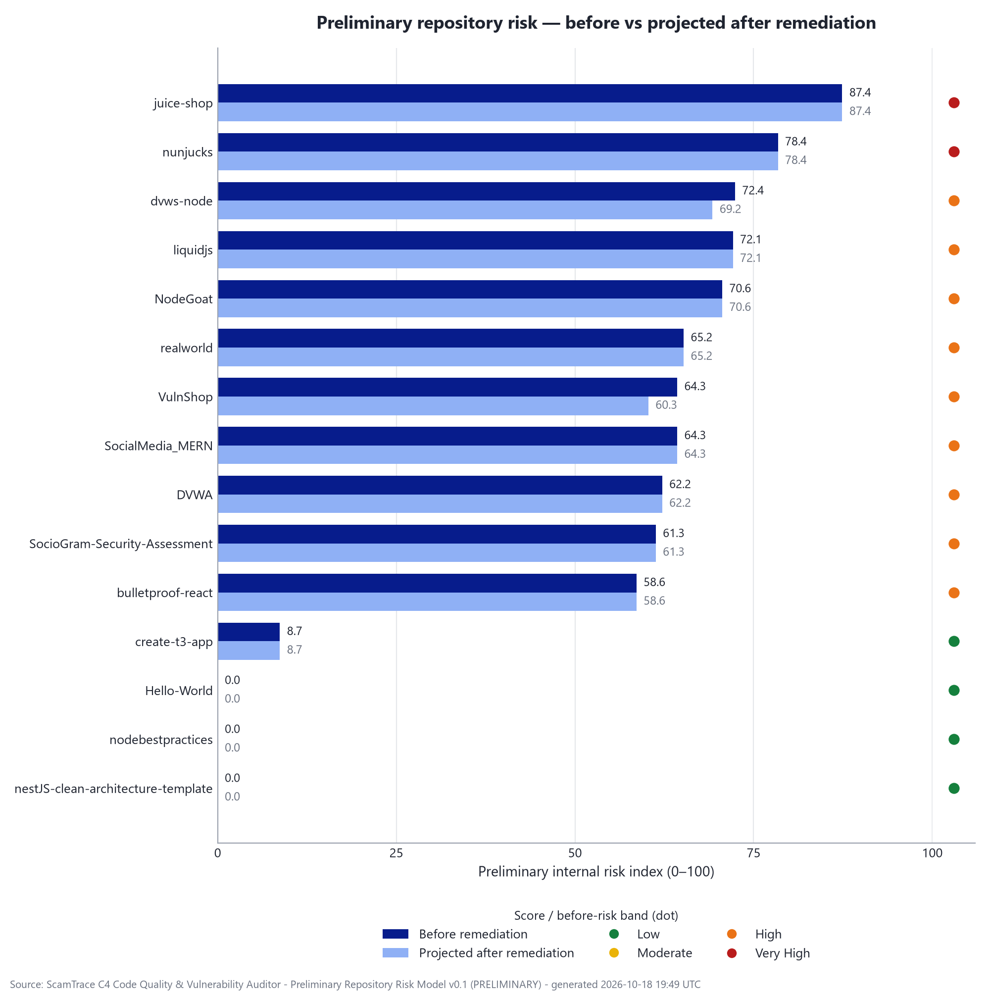
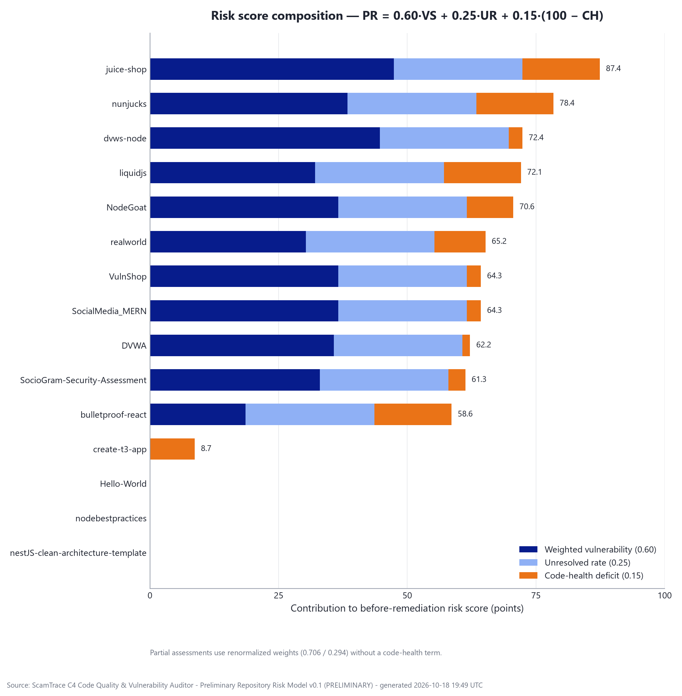
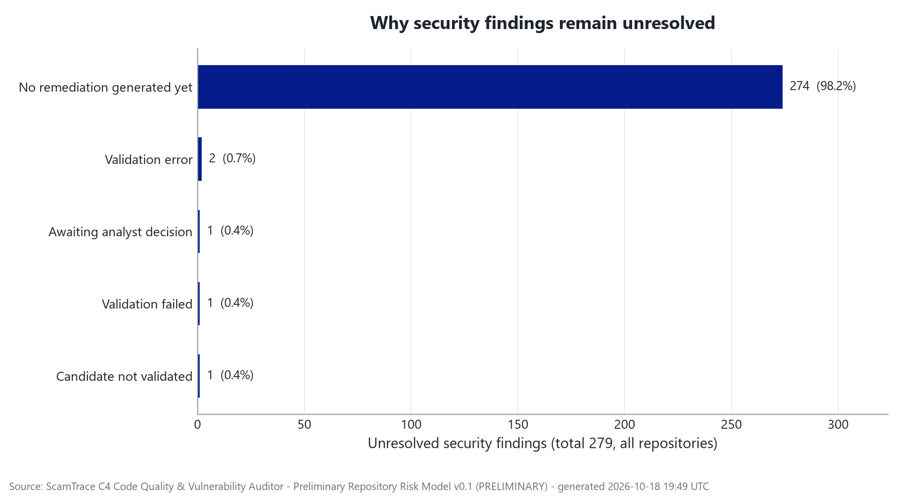
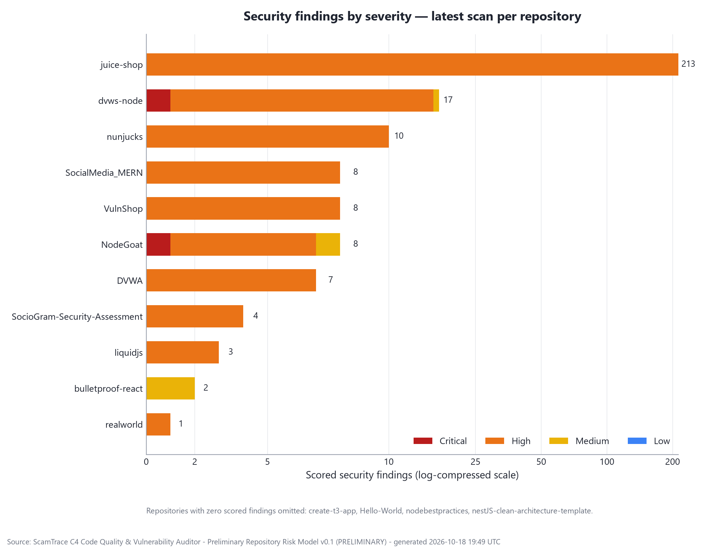
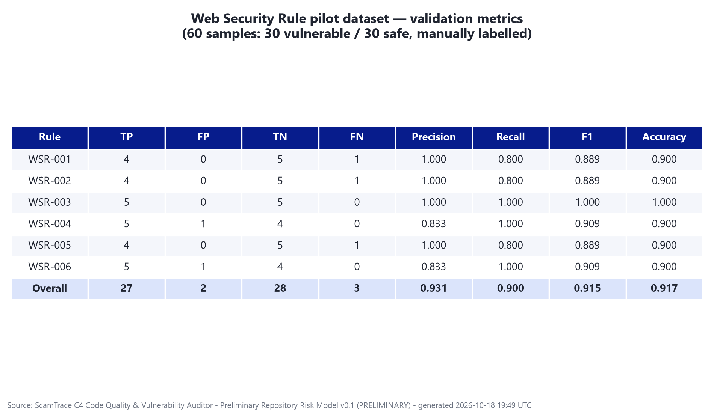
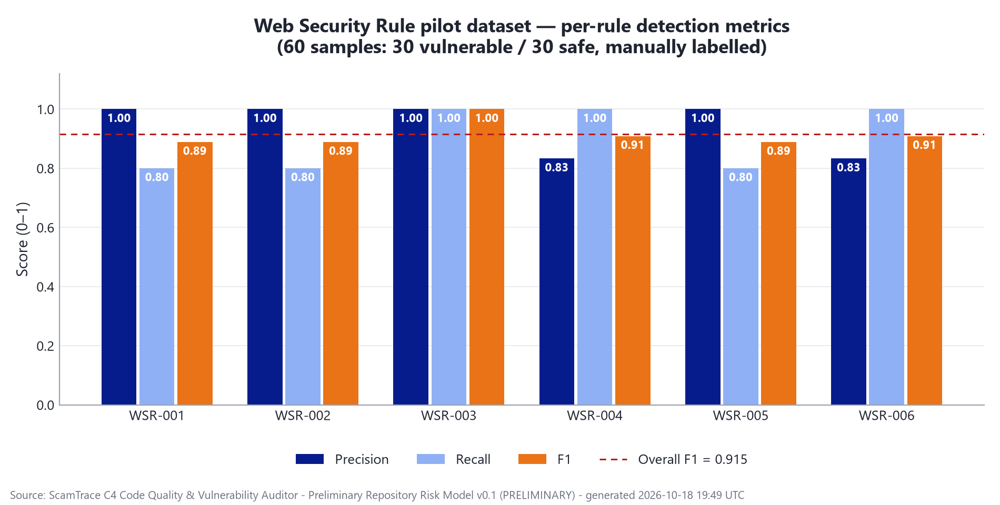

# PP1 Results — Preliminary Repository Risk Model (v0.1)

Generated by `research/risk-scoring/generate_results.py` on 2026-10-18 19:49 UTC from the
latest completed scan of each repository stored in the component database
(15 repositories). All values are actual calculations of
**ScamTrace Preliminary Repository Risk Model v0.1**
(status PRELIMINARY, validated: false);
nothing is hand-entered. Formulas: [`formula.md`](../formula.md).

> This score is an experimental repository-level risk indicator for PP1. It is not a CVSS score, exploit probability, or validated industry-standard metric. Projected results assume validated and analyst-accepted remediation candidates are subsequently applied.

## Table 1 — Preliminary risk per repository (before vs projected after)

Sorted by before-remediation risk, highest first.

| # | Repository | Findings (C/H/M/L) | Vulnerability score | Code health | Before risk | Band | Projected after | Band | Projected reduction |
|---|---|---|---|---|---|---|---|---|---|
| 1 | juice-shop | 0/213/0/0 | 79.00 | 0 (POOR) | **87.40** | VERY_HIGH | **87.40** | VERY_HIGH | 0.00 |
| 2 | nunjucks | 0/10/0/0 | 64.00 | 0 (POOR) | **78.40** | VERY_HIGH | **78.40** | VERY_HIGH | 0.00 |
| 3 | dvws-node | 1/15/1/0 | 74.50 | 82 (FAIR) | **72.40** | HIGH | **69.24** | HIGH | **−3.16** |
| 4 | liquidjs | 0/3/0/0 | 53.50 | 0 (POOR) | **72.10** | HIGH | **72.10** | HIGH | 0.00 |
| 5 | NodeGoat | 1/6/1/0 | 61.00 | 40 (POOR) | **70.60** | HIGH | **70.60** | HIGH | 0.00 |
| 6 | realworld | 0/1/0/0 | 50.50 | 34 (POOR) | **65.20** | HIGH | **65.20** | HIGH | 0.00 |
| 7 | VulnShop | 0/8/0/0 | 61.00 | 82 (FAIR) | **64.30** | HIGH | **60.27** | HIGH | **−4.03** |
| 8 | SocialMedia_MERN | 0/8/0/0 | 61.00 | 82 (FAIR) | **64.30** | HIGH | **64.30** | HIGH | 0.00 |
| 9 | DVWA | 0/7/0/0 | 59.50 | 90 (GOOD) | **62.20** | HIGH | **62.20** | HIGH | 0.00 |
| 10 | SocioGram-Security-Assessment | 0/4/0/0 | 55.00 | 78 (FAIR) | **61.30** | HIGH | **61.30** | HIGH | 0.00 |
| 11 | bulletproof-react | 0/0/2/0 | 31.00 | 0 (POOR) | **58.60** | HIGH | **58.60** | HIGH | 0.00 |
| 12 | create-t3-app | 0/0/0/0 | 0.00 | 42 (POOR) | **8.70** | LOW | **8.70** | LOW | 0.00 |
| 13 | Hello-World | 0/0/0/0 | 0.00 | unavailable | **0.00** | LOW | **0.00** | LOW | 0.00 |
| 14 | nodebestpractices | 0/0/0/0 | 0.00 | 100 (GOOD) | **0.00** | LOW | **0.00** | LOW | 0.00 |
| 15 | nestJS-clean-architecture-template | 0/0/0/0 | 0.00 | 100 (GOOD) | **0.00** | LOW | **0.00** | LOW | 0.00 |

Projected-after scores assume validated **and** analyst-accepted remediation
candidates are subsequently applied; the repositories themselves were not changed.

## Table 2 — Remediation / resolution state

| Repository | Security findings | Projected resolved | Unresolved | Top unresolved reasons |
|---|---|---|---|---|
| juice-shop | 213 | 0 | 213 | NO_REMEDIATION (212), NOT_VALIDATED (1) |
| nunjucks | 10 | 0 | 10 | NO_REMEDIATION (10) |
| dvws-node | 17 | 1 | 16 | NO_REMEDIATION (16) |
| liquidjs | 3 | 0 | 3 | NO_REMEDIATION (3) |
| NodeGoat | 8 | 0 | 8 | NO_REMEDIATION (8) |
| realworld | 1 | 0 | 1 | NO_REMEDIATION (1) |
| VulnShop | 8 | 1 | 7 | NO_REMEDIATION (5), VALIDATION_ERROR (1), VALIDATION_FAILED (1) |
| SocialMedia_MERN | 8 | 0 | 8 | NO_REMEDIATION (6), NO_ANALYST_DECISION (1), VALIDATION_ERROR (1) |
| DVWA | 7 | 0 | 7 | NO_REMEDIATION (7) |
| SocioGram-Security-Assessment | 4 | 0 | 4 | NO_REMEDIATION (4) |
| bulletproof-react | 2 | 0 | 2 | NO_REMEDIATION (2) |
| create-t3-app | 0 | 0 | 0 | — |
| Hello-World | 0 | 0 | 0 | — |
| nodebestpractices | 0 | 0 | 0 | — |
| nestJS-clean-architecture-template | 0 | 0 | 0 | — |
| **Total** | **281** | **2** | **279** | |

## Table 3 — Code health (AST code-quality findings)

Sorted by code health, lowest first.

| Repository | Long methods | Large files | Quality penalty | Code health | Label |
|---|---|---|---|---|---|
| Hello-World | n/a | n/a | n/a | unavailable | PARTIAL assessment |
| juice-shop | 429 | 9 | 876 | 0/100 | POOR |
| nunjucks | 148 | 12 | 320 | 0/100 | POOR |
| liquidjs | 84 | 4 | 176 | 0/100 | POOR |
| bulletproof-react | 73 | 0 | 146 | 0/100 | POOR |
| realworld | 31 | 2 | 66 | 34/100 | POOR |
| NodeGoat | 30 | 0 | 60 | 40/100 | POOR |
| create-t3-app | 29 | 0 | 58 | 42/100 | POOR |
| SocioGram-Security-Assessment | 11 | 0 | 22 | 78/100 | FAIR |
| dvws-node | 9 | 0 | 18 | 82/100 | FAIR |
| VulnShop | 9 | 0 | 18 | 82/100 | FAIR |
| SocialMedia_MERN | 9 | 0 | 18 | 82/100 | FAIR |
| DVWA | 4 | 1 | 10 | 90/100 | GOOD |
| nodebestpractices | 0 | 0 | 0 | 100/100 | GOOD |
| nestJS-clean-architecture-template | 0 | 0 | 0 | 100/100 | GOOD |

## Table 4 — Severity distribution

## Table 5 — Web Security Rule pilot dataset validation (WSR-001…006)

Six custom Tree-sitter web-security rules evaluated on the 60-sample pilot
dataset (30 vulnerable / 30 safe, manually labelled):

| Rule | TP | FP | TN | FN | Precision | Recall | F1 | Accuracy |
|---|---|---|---|---|---|---|---|---|
| WSR-001 | 4 | 0 | 5 | 1 | 1.000 | 0.800 | 0.889 | 0.900 |
| WSR-002 | 4 | 0 | 5 | 1 | 1.000 | 0.800 | 0.889 | 0.900 |
| WSR-003 | 5 | 0 | 5 | 0 | 1.000 | 1.000 | 1.000 | 1.000 |
| WSR-004 | 5 | 1 | 4 | 0 | 0.833 | 1.000 | 0.909 | 0.900 |
| WSR-005 | 4 | 0 | 5 | 1 | 1.000 | 0.800 | 0.889 | 0.900 |
| WSR-006 | 5 | 1 | 4 | 0 | 0.833 | 1.000 | 0.909 | 0.900 |
| **Overall** | **27** | **2** | **28** | **3** | **0.931** | **0.900** | **0.915** | **0.917** |

## Table 6 — Scan provenance

| Repository | Scan ID | Scanned (UTC) | Assessment completeness |
|---|---|---|---|
| juice-shop | `SCAN-4A297EEF924A` | 2026-10-18T09:24:49 | COMPLETE |
| nunjucks | `SCAN-2412DFA7ED6B` | 2026-10-17T18:36:26 | COMPLETE |
| dvws-node | `SCAN-311BE764C4EE` | 2026-10-18T13:17:26 | COMPLETE |
| liquidjs | `SCAN-688EB217D29F` | 2026-10-17T18:58:51 | COMPLETE |
| NodeGoat | `SCAN-D89229407373` | 2026-10-17T19:04:00 | COMPLETE |
| realworld | `SCAN-AF0D1C88E434` | 2026-10-17T19:21:19 | COMPLETE |
| VulnShop | `SCAN-455987FB2E9F` | 2026-10-12T19:43:10 | COMPLETE |
| SocialMedia_MERN | `SCAN-29AF5433DA58` | 2026-10-13T19:31:56 | COMPLETE |
| DVWA | `SCAN-88E3CA5A163E` | 2026-10-17T19:13:15 | COMPLETE |
| SocioGram-Security-Assessment | `SCAN-FD85DA8CEC56` | 2026-10-18T07:25:21 | COMPLETE |
| bulletproof-react | `SCAN-188BD50E7215` | 2026-10-17T19:32:35 | COMPLETE |
| create-t3-app | `SCAN-D30210A9C62A` | 2026-10-18T06:38:48 | COMPLETE |
| Hello-World | `SCAN-ABF44118B7D0` | 2026-10-15T18:28:32 | PARTIAL |
| nodebestpractices | `SCAN-880B9CB5B98D` | 2026-10-17T19:19:52 | COMPLETE |
| nestJS-clean-architecture-template | `SCAN-3EE180160AF7` | 2026-10-18T06:40:50 | COMPLETE |

## Notes

- The risk index is a preliminary internal research indicator (0–100), not CVSS,
  not EPSS and not a probability of exploitation.
- Scores recompute from stored findings, patch validations and analyst decisions
  at generation time; re-running this script after new reviews changes the results.
- The pilot dataset is synthetic and small (60 samples); PP2 plans evaluation on
  external datasets and real repositories (see `pp2-dataset-candidates.md`).
